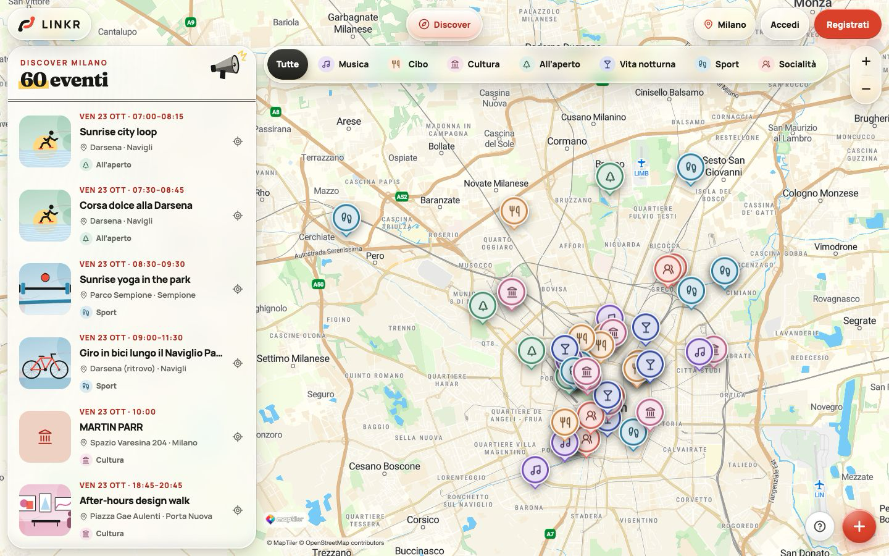
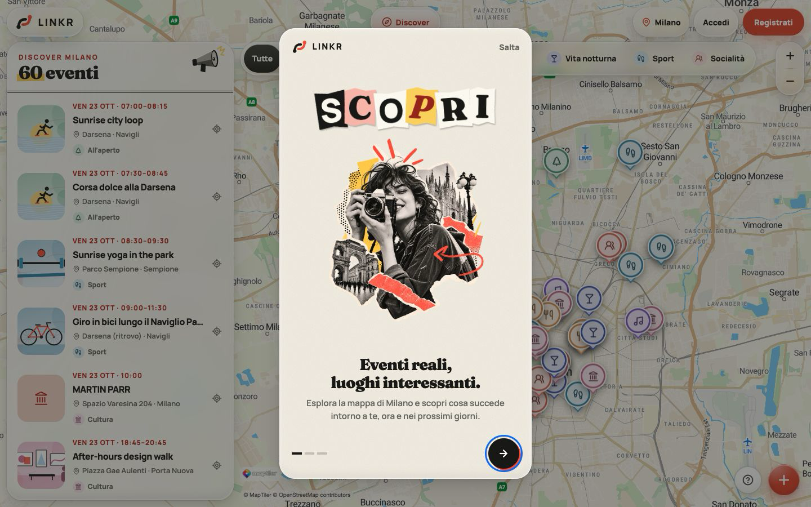
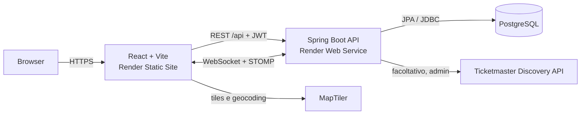
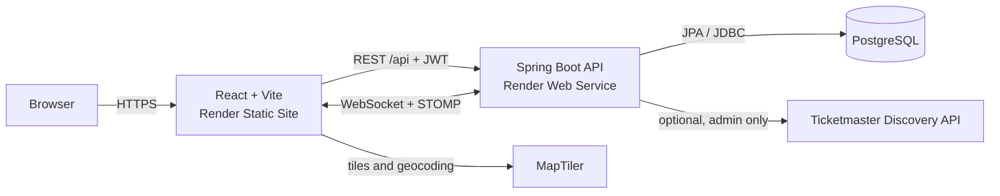

<a id="italiano"></a>

[Italiano](#italiano) | [English](#english)

# LINKR

LINKR è una web application full-stack mobile-first per scoprire eventi, trovare persone con interessi compatibili e partecipare a esperienze reali. Il prodotto nasce da un problema concreto: gli eventi sono facili da elencare, ma è più difficile capire cosa succede vicino a sé, chi condivide gli stessi interessi e con chi si può restare in contatto dopo l'evento.

L'applicazione riunisce questi passaggi in un unico flusso: esplorazione su mappa, dettaglio e partecipazione agli eventi, scoperta volontaria delle persone, richieste Link e messaggistica privata.

## Applicazione online

| Risorsa | Link |
|---|---|
| Frontend | [linkr-web.onrender.com](https://linkr-web.onrender.com) |
| Stato del backend | [linkr-api-9ezt.onrender.com/api/health](https://linkr-api-9ezt.onrender.com/api/health) |
| Repository | [github.com/Javier21122000/linkr-capstone](https://github.com/Javier21122000/linkr-capstone) |

I tre collegamenti sono stati verificati il 23 ottobre 2026. Il deploy pubblico usa risorse Render Free: dopo un periodo di inattività il backend può richiedere un cold start e le prime richieste possono impiegare più tempo o dover essere ripetute.

## Screenshot





Schermate acquisite dall'applicazione LINKR in esecuzione locale: Discover e la prima schermata dell'onboarding.

## Funzionalità principali

- **Scoperta degli eventi su mappa:** lista e mappa MapLibre sincronizzate, marker, categorie, filtri temporali, ricerca per luogo e ricentramento della camera sull'evento selezionato.
- **Dettaglio e gestione degli eventi:** pagine pubbliche di dettaglio; gli utenti autenticati possono creare, modificare ed eliminare i propri eventi, con validazione e ricerca del luogo tramite MapTiler.
- **Partecipazione:** stati `INTERESTED` e `GOING`, agenda personale e indicatori di partecipazione.
- **Autenticazione e autorizzazione:** registrazione e login, password BCrypt, API stateless protette da JWT e ruoli `USER`/`ADMIN`.
- **Profili e interessi:** profilo modificabile, avatar, biografia, catalogo degli interessi e profili pubblici con le sole informazioni previste dall'API.
- **Scoperta delle persone opt-in:** un utente compare in Discover People solo dopo aver abilitato esplicitamente la visibilità; i risultati tengono conto degli interessi condivisi e delle partecipazioni visibili.
- **Link e connessioni:** invio, accettazione e rifiuto delle richieste Link, con stati coerenti anche in caso di richieste concorrenti.
- **Messaggistica privata:** conversazioni disponibili tra Link accettati; invio e storico via REST, notifiche in tempo reale tramite WebSocket/STOMP e badge dei non letti.
- **Amministrazione:** area protetta per utenti `ADMIN` e strumenti Ticketmaster di dry-run/importazione manuale.
- **Onboarding e guida contestuale:** percorso editoriale introduttivo, suggerimenti progressivi e tour delle funzioni principali.
- **Immagini:** upload JPEG/PNG con controllo del contenuto reale, limite di dimensione, rate limit, nomi casuali e rimozione dei metadati.
- **Eventi esterni:** l'integrazione Ticketmaster esiste ma è **disattivata di default**. Il dry-run richiede l'abilitazione generale e il ruolo admin; l'importazione persistente richiede un secondo interruttore esplicito. Non esiste uno scheduler automatico.

## Architettura



Il frontend e il backend sono distribuiti su domini separati. Il browser chiama direttamente le API e l'endpoint WebSocket; il backend autorizza solo le origini configurate. Spring Boot contiene i moduli di autenticazione, eventi, partecipazioni, profili, discovery, Link, chat, upload e amministrazione. PostgreSQL conserva lo stato applicativo e Flyway applica le migrazioni versionate; Hibernate valida lo schema senza modificarlo.

La configurazione Render, il routing SPA, CORS, i controlli di avvio e gli smoke test sono documentati in [`docs/DEPLOY.md`](docs/DEPLOY.md).

## Stack tecnologico

Versioni verificate nei manifest del repository:

| Area | Tecnologie |
|---|---|
| Frontend | React 19.3.0, React Router 8.4.0, TypeScript 7.0.2, Vite 8.3.4 |
| UI e mappa | Tailwind CSS 4.3.3, CSS dedicato, Lucide React 1.55.0, MapLibre GL JS 6.15.0, MapTiler |
| Comunicazione | Axios 1.20.0, `@stomp/stompjs` 7.2.1 |
| Backend | Java 21, Spring Boot 4.1.1, Spring MVC, Spring Security, OAuth2 Resource Server, Spring Data JPA, Spring WebSocket |
| Dati | PostgreSQL, Flyway, Hibernate |
| Build e deploy | npm, Maven Wrapper 3.9.16, Docker multi-stage, Render Static Site/Web Service/PostgreSQL |
| Test | `node:test`, Spring Boot Test, JUnit, MockMvc, test di integrazione su database dedicato |

## Decisioni ingegneristiche

### Frontend tipizzato e routing nel browser

React e TypeScript dividono la UI in pagine, componenti e logica pura verificabile. Le pagine autenticate meno frequenti vengono caricate in modo lazy; Discover resta montata durante la navigazione per evitare di ricreare inutilmente la mappa. Il routing è client-side, quindi il deploy statico richiede una rewrite verso `index.html`.

### API stateless con JWT

Spring Security tratta il backend come resource server stateless. Il JWT viaggia nell'header `Authorization`, contiene i ruoli e scade dopo due ore per impostazione predefinita; non sono usati cookie né refresh token. Il frontend conserva il token in `sessionStorage`: sopravvive al refresh della pagina ma termina con la sessione del browser. È un compromesso semplice, ma un eventuale XSS potrebbe leggere il token; la prevenzione delle injection e una CSP verificata restano necessarie.

### PostgreSQL e migrazioni controllate

Le relazioni tra utenti, eventi, partecipazioni, interessi, Link e messaggi beneficiano di vincoli e transazioni relazionali. Flyway porta lo schema da V1 a V9, mentre `ddl-auto=validate` impedisce a Hibernate di alterarlo implicitamente. Una strategia di migrazione controlla anche il nome del database per ridurre il rischio di migrare l'istanza sbagliata.

### MapLibre con servizi MapTiler

MapLibre gestisce il rendering e mantiene il frontend indipendente da un renderer proprietario. MapTiler fornisce stile cartografico e ricerca dei luoghi tramite una chiave pubblica limitabile per origine. La lista degli eventi può restare disponibile quando la cartografia è lenta o degradata; i marker dipendono dal canvas MapLibre e potrebbero non essere utilizzabili se il rendering della mappa non funziona.

### REST per i messaggi, STOMP per gli aggiornamenti

I messaggi vengono validati e persistiti tramite REST; WebSocket/STOMP notifica in tempo reale il destinatario su una coda privata. L'autenticazione avviene nel frame STOMP `CONNECT`. Il broker semplice è adatto a una singola istanza, ma per scalare orizzontalmente servirebbe un broker esterno.

### Mobile-first senza duplicare l'applicazione

La stessa struttura React adatta navigazione, pannelli, mappe e chat alle diverse viewport. Le funzioni geometriche e di layout più delicate sono separate dai componenti e coperte da test; gli stili rispettano anche `prefers-reduced-motion`.

## Privacy e controllo dei dati

- La presenza in Discover People è facoltativa: ogni utente decide se rendere visibile il proprio profilo in quella sezione.
- Le conversazioni sono disponibili solo tra utenti che hanno accettato una richiesta Link.
- I profili pubblici espongono un insieme limitato di dati, senza email, ruolo, data di iscrizione o stato di visibilità.

## Problemi affrontati e soluzioni

Durante lo sviluppo sono state affrontate problematiche di prestazioni, sicurezza, integrazione e UX. Le sezioni seguenti descrivono alcuni casi, le soluzioni implementate e i compromessi che restano.

### Mappa vuota, lenta o con contesto WebGL perso

1. **Problema:** il canvas poteva non produrre tile visibili, rimanere in caricamento o perdere il contesto WebGL; su infrastruttura Free anche una risposta API lenta rendeva ambiguo lo stato iniziale.
2. **Impatto:** Discover sembrava bloccata anche se lista eventi e controlli erano ancora utilizzabili.
3. **Indagine:** la logica è stata separata in stati osservabili (`loading`, `ready`, `recovering`, `degraded`, `error`, `missing-key`) e in controlli sul canvas, sulle tile e sugli errori MapLibre. I casi di recovery hanno test dedicati.
4. **Soluzione:** tentativi automatici limitati, ricreazione controllata della mappa, gestione della perdita WebGL, messaggi distinti per chiave assente/errori permanenti e un'azione manuale di retry. Lo splash attende router ed eventi, non il rendering cartografico, e ha un limite massimo.
5. **Trade-off:** una chiave MapTiler non valida o una rete indisponibile non possono essere corrette dal client. La lista eventi può restare disponibile, mentre i marker potrebbero non essere utilizzabili se il canvas MapLibre non riesce a renderizzare.

### Evento selezionato coperto dai pannelli

1. **Problema:** centrare un marker sul centro matematico della mappa non garantiva che fosse visibile: lista, filtri, anteprima e controlli occupano aree diverse su desktop e mobile.
2. **Impatto:** la selezione poteva spostare il marker dietro un pannello o produrre animazioni ripetute.
3. **Indagine:** il target è stato modellato come centro dell'area realmente libera, con margini misurati e una tolleranza in pixel.
4. **Soluzione:** `selectionFraming` calcola il punto utile; la camera si muove solo quando il marker è fuori tolleranza. Test geometrici coprono viewport e margini asimmetrici.
5. **Trade-off:** l'inquadratura dipende dalle dimensioni misurate dell'interfaccia e deve essere aggiornata se i pannelli cambiano struttura.

### Layout della chat su viewport piccole

1. **Problema:** tastiera virtuale, area messaggi e composer competevano per l'altezza disponibile sui dispositivi mobili.
2. **Impatto:** l'ultimo messaggio o il campo di scrittura potevano uscire dall'area utile.
3. **Indagine:** il calcolo dell'altezza è stato isolato dalla pagina e verificato con test di layout.
4. **Soluzione:** uso della viewport visuale disponibile, ridimensionamento del thread e stili responsive specifici per mantenere composer e messaggi accessibili.
5. **Trade-off:** il comportamento delle tastiere resta dipendente dal browser mobile; i test puri verificano i calcoli, non ogni combinazione dispositivo/browser.

### Persistenza della sessione e aggiornamenti realtime

1. **Problema:** un refresh non doveva far perdere immediatamente l'accesso, ma token scaduti e connessioni STOMP non dovevano sopravvivere oltre la sessione valida.
2. **Impatto:** stato di autenticazione, badge e messaggi potevano divergere dall'API.
3. **Indagine:** autenticazione, storage e lifecycle WebSocket sono stati centralizzati nei rispettivi context; gli errori di autorizzazione vengono gestiti in modo uniforme.
4. **Soluzione:** sessione in `localStorage` (sopravvive alla chiusura della web app fino alla scadenza del token), scadenza verificata all'avvio e al ritorno in primo piano, logout che rimuove lo stato, connessione STOMP associata all'utente autenticato e messaggi persistiti via REST prima della notifica.
5. **Trade-off:** non esiste refresh token; dopo la scadenza (2 ore di default) occorre accedere di nuovo. Lo storage del browser, `sessionStorage` o `localStorage`, non elimina il rischio XSS; la persistenza più lunga è una proposta da approvare in [`docs/PROPOSTE-SESSIONI-E-INVITI.md`](docs/PROPOSTE-SESSIONI-E-INVITI.md).

### Schema, dati demo e sicurezza delle migrazioni

1. **Problema:** test e seed non dovevano alterare database sbagliati, duplicare contenuti o sovrascrivere dati reali.
2. **Impatto:** un avvio con configurazione errata avrebbe potuto compromettere dati di sviluppo o deploy.
3. **Indagine:** sono stati introdotti un database di test dedicato, controlli sul nome del database e test di upgrade Flyway su schemi popolati.
4. **Soluzione:** migrazioni versionate, validazione Hibernate, guardia `LINKR_DB_EXPECTED_NAME` e seed demo idempotenti attivi solo con profilo `dev`/`demo` e interruttore esplicito. I dati demo usano identificatori riconoscibili e non cancellano righe reali.
5. **Trade-off:** disabilitare un seeder non rimuove i dati già inseriti; la rimozione resta un'operazione amministrativa esplicita.

### Frontend e backend su domini distinti

1. **Problema:** REST e WebSocket vengono chiamati dal browser da un'origine diversa da quella dell'API.
2. **Impatto:** una configurazione incompleta produce errori CORS o handshake WebSocket rifiutati, anche con servizi funzionanti.
3. **Indagine:** origini, metodi, header e preflight sono verificati da test backend e dalla checklist di deploy.
4. **Soluzione:** allowlist esatta in `CORS_ALLOWED_ORIGINS`, stessa policy per `/api/**` e `/ws`, URL API incorporato nel bundle tramite `VITE_API_BASE_URL` e smoke test per preflight e upgrade WebSocket.
5. **Trade-off:** ogni nuovo dominio o preview URL deve essere aggiunto esplicitamente e una modifica alle variabili Vite richiede una nuova build.

### Routing SPA e cold start su Render

1. **Problema:** un refresh su una rotta React profonda può restituire 404; inoltre un backend Free inattivo può non rispondere entro il timeout client di 10 secondi.
2. **Impatto:** link condivisi e primo accesso potevano apparire guasti.
3. **Indagine:** la procedura di deploy include richieste dirette alle rotte, health check e misurazione del primo avvio.
4. **Soluzione:** rewrite Render `/* → /index.html`, health endpoint dedicato, stati di caricamento con uscita garantita e istruzioni per risvegliare il servizio prima di una demo.
5. **Trade-off:** il cold start è una proprietà dell'infrastruttura gratuita; eliminarlo richiede risorse sempre attive.

### Upload di immagini e metadati

1. **Problema:** estensione e `Content-Type` dichiarati dal client non bastano a stabilire il formato; le immagini possono contenere EXIF o altri metadati sensibili.
2. **Impatto:** file non validi, consumo eccessivo di risorse o dati non necessari potevano raggiungere lo storage pubblico.
3. **Indagine:** fixture reali e sintetiche coprono firme, struttura, limiti e metadati JPEG/PNG.
4. **Soluzione:** ispezione del contenuto, limiti multipart, rate limit per utente, nomi UUID, rimozione dei metadati e test unitari/integrati della pipeline.
5. **Trade-off:** sul piano Render Free lo storage locale è effimero; un deploy o riavvio può rimuovere gli upload. Per dati persistenti serve uno storage esterno o un disco persistente.

## Installazione e sviluppo locale

### Prerequisiti

- Git.
- Java 21. Maven non deve essere installato: il repository include il wrapper Maven 3.9.16.
- Node.js `^20.19.0` oppure `>=22.12.0`; per eseguire direttamente i test TypeScript con `node:test` è consigliato Node `>=22.18`.
- PostgreSQL in esecuzione e un database locale chiamato `linkr_db`.
- Una chiave pubblica MapTiler per visualizzare la mappa e cercare luoghi.

### Configurazione

```bash
git clone https://github.com/Javier21122000/linkr-capstone.git
cd linkr-capstone
cp .env.example .env
```

Creare il database senza inserire credenziali nel repository:

```sql
CREATE DATABASE linkr_db;
```

Compilare `.env` con valori locali. Le variabili minime sono:

```dotenv
LINKR_DB_URL=jdbc:postgresql://localhost:5432/linkr_db
LINKR_DB_USERNAME=postgres
LINKR_DB_PASSWORD=your-local-password
LINKR_JWT_SECRET=generate-a-random-secret-of-at-least-32-characters
VITE_MAPTILER_KEY=your-public-maptiler-key
```

Generare il segreto JWT, per esempio, con `openssl rand -base64 48`. Non commettere `.env`: il file è ignorato da Git. Vite legge il file dalla radice tramite `envDir`; Spring Boot richiede invece che le variabili siano esportate nella shell.

### Backend

```bash
set -a
source .env
set +a
cd backend
./mvnw spring-boot:run
```

L'API è disponibile su `http://localhost:8080`; l'health check è `http://localhost:8080/api/health`. Flyway crea e aggiorna lo schema all'avvio.

### Frontend

In un secondo terminale:

```bash
cd frontend
npm ci
npm run dev
```

Il frontend è disponibile su `http://localhost:5173`. In sviluppo Vite inoltra `/api` e `/ws` al backend locale. `VITE_API_BASE_URL` può quindi restare vuota.

## Test

Frontend:

```bash
cd frontend
npm run typecheck
npm test
npm run build
```

I test coprono, tra le altre aree, navigazione, autenticazione lato client, filtri, formulari, orari `Europe/Rome` e passaggi DST, camera e recovery della mappa, layout chat, onboarding, splash e accessibilità/stili editoriali.

Backend:

```bash
cd backend
./mvnw test
```

I test backend includono API e sicurezza, eventi e partecipazioni, interessi e profili, discovery e concorrenza delle richieste Link, chat/WebSocket, upload e sanitizzazione dei metadati, Ticketmaster, CORS, migrazioni e isolamento del database. I test di integrazione usano `linkr_test_db`: configurare prima credenziali locali dedicate come descritto in [`docs/DEPLOY.md`](docs/DEPLOY.md#7-test-backend-sul-database-di-test-facoltativo-in-locale).

Non viene dichiarata una percentuale di copertura.

## Deploy

Il deploy pubblico è composto da:

- un Render Static Site per `frontend/dist`;
- un Render Web Service Docker per il backend Spring Boot;
- un database PostgreSQL;
- MapTiler come servizio esterno per cartografia e geocoding;
- Ticketmaster solo quando l'integrazione viene abilitata esplicitamente.

Variabili, CORS, rewrite SPA, profilo demo, smoke test e limiti operativi sono descritti in [`docs/DEPLOY.md`](docs/DEPLOY.md). La pipeline delle immagini è descritta in [`docs/UPLOAD-IMMAGINI.md`](docs/UPLOAD-IMMAGINI.md), l'integrazione esterna in [`docs/TICKETMASTER.md`](docs/TICKETMASTER.md) e i dati dimostrativi in [`docs/COMMUNITY-DEMO.md`](docs/COMMUNITY-DEMO.md).

## Limiti e roadmap

### Limiti attuali

- Il deploy pubblico contiene dati dimostrativi inventati e chiaramente marcati; non rappresenta eventi o persone reali.
- Le risorse Render Free possono andare in sleep, il PostgreSQL gratuito ha vincoli temporali/operativi e gli upload sul filesystem del backend non sono persistenti.
- Il broker STOMP e i limiti di upload sono in memoria e presuppongono una singola istanza backend.
- Il JWT non ha refresh token e scade dopo due ore per impostazione predefinita.
- Non è presente protezione dedicata contro tentativi ripetuti di login/registrazione.
- Ticketmaster è disattivato di default e non esegue importazioni automatiche.
- La CSP documentata deve essere verificata sul deploy a domini separati prima di essere considerata una protezione attiva.
- Gli screenshot autenticati non sono ancora mantenuti nel repository.

### Evoluzioni possibili

- storage oggetti persistente per avatar e copertine;
- broker esterno e stato condiviso per più istanze backend;
- rate limiting distribuito e protezioni aggiuntive sull'autenticazione;
- osservabilità di database e dipendenze nel health check;
- pipeline automatizzata per test, build e controllo delle migrazioni;
- ulteriori screenshot reali, aggiornati insieme alle principali revisioni UI.

Questi punti sono piani, non funzionalità già disponibili.

## Autore

Javier Torres

---

<a id="english"></a>

[Italiano](#italiano) | [English](#english)

# LINKR

LINKR is a mobile-first full-stack web application for discovering events, finding people with compatible interests, and taking part in real-world experiences. It addresses a practical gap: listing events is relatively easy, but understanding what is happening nearby, who shares the same interests, and who to stay in touch with afterwards is harder.

The application brings those steps into one flow: map-based exploration, event details and participation, opt-in people discovery, Link requests, and private messaging.

## Live application

| Resource | Link |
|---|---|
| Frontend | [linkr-web.onrender.com](https://linkr-web.onrender.com) |
| Backend health | [linkr-api-9ezt.onrender.com/api/health](https://linkr-api-9ezt.onrender.com/api/health) |
| Repository | [github.com/Javier21122000/linkr-capstone](https://github.com/Javier21122000/linkr-capstone) |

All three links were verified on October 23, 2026. The public deployment uses Render Free resources: after a period of inactivity the backend may need a cold start, so the first requests can take longer or need to be retried.

## Screenshot


Screens captured from the LINKR application running locally: Discover and the first onboarding screen.

## Main functionality

- **Map-based event discovery:** synchronized MapLibre list and map, markers, categories, date filters, place search, and camera framing for the selected event.
- **Event details and management:** public detail pages; authenticated users can create, edit, and delete their own events, with validation and MapTiler place search.
- **Participation:** `INTERESTED` and `GOING` states, personal agenda, and participation indicators.
- **Authentication and authorization:** registration and login, BCrypt passwords, stateless JWT-protected APIs, and `USER`/`ADMIN` roles.
- **Profiles and interests:** editable profile, avatar, biography, interest catalogue, and public profiles containing only the fields exposed by the API.
- **Opt-in people discovery:** users only appear in Discover People after explicitly enabling visibility; results consider shared interests and visible event participation.
- **Links and connections:** Link request creation, acceptance, and rejection, with consistent states under concurrent requests.
- **Private messaging:** conversations between accepted Links; REST delivery and history, realtime WebSocket/STOMP notifications, and unread badges.
- **Administration:** an `ADMIN`-protected area and manual Ticketmaster dry-run/import tools.
- **Onboarding and contextual guidance:** an editorial introduction, progressive hints, and a tour of the main features.
- **Images:** JPEG/PNG upload with content inspection, size limits, rate limits, random names, and metadata removal.
- **External events:** the Ticketmaster integration exists but is **disabled by default**. Dry runs require the general switch and an admin account; persistent imports require a second explicit switch. There is no automatic scheduler.

## Architecture



The frontend and backend are deployed on separate domains. The browser calls the APIs and WebSocket endpoint directly; the backend only allows configured origins. Spring Boot contains the authentication, event, participation, profile, discovery, Link, chat, upload, and administration modules. PostgreSQL stores application state and Flyway applies versioned migrations; Hibernate validates the schema without modifying it.

Render configuration, SPA routing, CORS, startup checks, and smoke tests are documented in [`docs/DEPLOY.md`](docs/DEPLOY.md).

## Technology stack

Versions verified from the repository manifests:

| Area | Technologies |
|---|---|
| Frontend | React 19.3.0, React Router 8.4.0, TypeScript 7.0.2, Vite 8.3.4 |
| UI and map | Tailwind CSS 4.3.3, dedicated CSS, Lucide React 1.55.0, MapLibre GL JS 6.15.0, MapTiler |
| Communication | Axios 1.20.0, `@stomp/stompjs` 7.2.1 |
| Backend | Java 21, Spring Boot 4.1.1, Spring MVC, Spring Security, OAuth2 Resource Server, Spring Data JPA, Spring WebSocket |
| Data | PostgreSQL, Flyway, Hibernate |
| Build and deployment | npm, Maven Wrapper 3.9.16, multi-stage Docker, Render Static Site/Web Service/PostgreSQL |
| Testing | `node:test`, Spring Boot Test, JUnit, MockMvc, integration tests on a dedicated database |

## Engineering decisions

### Typed frontend and browser routing

React and TypeScript divide the UI into pages, components, and testable pure logic. Less frequently used authenticated pages are lazy-loaded; Discover remains mounted during navigation to avoid unnecessarily recreating the map. Routing is client-side, so the static deployment needs a rewrite to `index.html`.

### Stateless JWT API

Spring Security treats the backend as a stateless resource server. The JWT travels in the `Authorization` header, contains roles, and expires after two hours by default; cookies and refresh tokens are not used. The frontend stores the token in `sessionStorage`: it survives a page refresh but ends with the browser session. This is a simple compromise, but XSS could still read the token; injection prevention and a verified CSP remain necessary.

### PostgreSQL and guarded migrations

Relationships between users, events, participation, interests, Links, and messages benefit from relational constraints and transactions. Flyway evolves the schema from V1 to V9, while `ddl-auto=validate` prevents Hibernate from changing it implicitly. A guarded migration strategy also checks the database name to reduce the risk of migrating the wrong instance.

### MapLibre with MapTiler services

MapLibre handles rendering and keeps the frontend independent from a proprietary renderer. MapTiler provides the map style and place search through a public key that can be restricted by origin. The event list may remain available when map tiles are slow or degraded; markers depend on the MapLibre canvas and may not be usable if map rendering fails.

### REST for messages, STOMP for updates

Messages are validated and persisted through REST; WebSocket/STOMP notifies the recipient in realtime on a private queue. Authentication happens in the STOMP `CONNECT` frame. The simple broker suits a single instance, but horizontal scaling would require an external broker.

### Mobile-first without a second application

The same React structure adapts navigation, panels, maps, and chat to different viewports. Sensitive geometry and layout functions are separated from components and covered by tests; styles also respect `prefers-reduced-motion`.

## Privacy and data control

- Appearing in Discover People is optional: each user decides whether their profile is visible in that section.
- Conversations are available only between users who have accepted a Link request.
- Public profiles expose a limited set of data and omit email, role, registration date, and visibility status.

## Problems encountered and solutions

Development involved performance, security, integration, and UX challenges. The following sections describe selected cases, the implemented solutions, and the trade-offs that remain.

### Blank, slow, or lost-WebGL map

1. **Problem:** the canvas could fail to produce visible tiles, remain in a loading state, or lose its WebGL context; on Free infrastructure, a slow API response also made the initial state ambiguous.
2. **Why it mattered:** Discover appeared blocked even when the event list and controls were still usable.
3. **Investigation:** the logic was divided into observable states (`loading`, `ready`, `recovering`, `degraded`, `error`, `missing-key`) and checks for canvas output, tile activity, and MapLibre errors. Recovery paths have dedicated tests.
4. **Solution:** bounded automatic retries, controlled map recreation, WebGL-loss handling, distinct messages for missing keys/permanent errors, and a manual retry action. The boot splash waits for the router and events—not map rendering—and has a maximum duration.
5. **Trade-off:** the client cannot repair an invalid MapTiler key or unavailable network. The event list may remain available, while markers may not be usable if the MapLibre canvas cannot render.

### Selected event hidden by interface panels

1. **Problem:** centering a marker on the mathematical center of the map did not guarantee visibility because the list, filters, preview, and controls occupy different areas on desktop and mobile.
2. **Why it mattered:** a selected marker could move behind a panel or trigger repeated animations.
3. **Investigation:** the target was modelled as the centre of the truly free area, using measured insets and a pixel tolerance.
4. **Solution:** `selectionFraming` calculates the useful target; the camera only moves when the marker is outside tolerance. Geometry tests cover asymmetric viewports and insets.
5. **Trade-off:** framing depends on measured UI dimensions and must be updated when the panel structure changes.

### Chat layout on small viewports

1. **Problem:** the virtual keyboard, message area, and composer competed for available height on mobile devices.
2. **Why it mattered:** the newest message or writing field could move outside the usable area.
3. **Investigation:** height calculation was isolated from the page and checked with layout tests.
4. **Solution:** visual-viewport-aware sizing, thread resizing, and responsive styles keep messages and the composer reachable.
5. **Trade-off:** virtual keyboards still vary by mobile browser; pure tests verify calculations, not every device/browser combination.

### Session persistence and realtime updates

1. **Problem:** refreshes should not immediately sign users out, while expired tokens and STOMP connections must not survive an invalid session.
2. **Why it mattered:** authentication state, badges, and messages could diverge from the API.
3. **Investigation:** authentication, storage, and WebSocket lifecycles were centralized in their contexts; authorization failures use a consistent path.
4. **Solution:** session state in `localStorage` (it survives closing the web app until the token expires), expiry checks at startup and on returning to the foreground, logout state removal, a STOMP connection tied to the authenticated user, and REST persistence before notification.
5. **Trade-off:** there is no refresh token, so users sign in again after expiry (two hours by default). Browser storage, whether `sessionStorage` or `localStorage`, does not remove XSS risk; longer persistence is a proposal awaiting approval in [`docs/PROPOSTE-SESSIONI-E-INVITI.md`](docs/PROPOSTE-SESSIONI-E-INVITI.md).

### Schema, demo data, and migration safety

1. **Problem:** tests and seeders must not alter the wrong database, duplicate content, or overwrite real data.
2. **Why it mattered:** a misconfigured start could damage development or deployed data.
3. **Investigation:** a dedicated test database, database-name checks, and Flyway upgrade tests on populated schemas were introduced.
4. **Solution:** versioned migrations, Hibernate validation, the `LINKR_DB_EXPECTED_NAME` guard, and idempotent demo seeders enabled only through a `dev`/`demo` profile plus an explicit switch. Demo data uses recognizable identifiers and never deletes real rows.
5. **Trade-off:** disabling a seeder does not remove data already inserted; removal remains an explicit administrative operation.

### Frontend and backend on separate domains

1. **Problem:** REST and WebSocket calls originate from a domain different from the API.
2. **Why it mattered:** incomplete settings caused CORS failures or rejected WebSocket handshakes even when both services were healthy.
3. **Investigation:** origins, methods, headers, and preflights are covered by backend tests and the deployment checklist.
4. **Solution:** an exact `CORS_ALLOWED_ORIGINS` allowlist, the same policy for `/api/**` and `/ws`, an API URL embedded through `VITE_API_BASE_URL`, and smoke tests for preflight and WebSocket upgrade.
5. **Trade-off:** each new domain or preview URL must be added explicitly, and changes to Vite variables require a rebuild.

### SPA routing and Render cold starts

1. **Problem:** refreshing a deep React route can return 404; an idle Free backend may also miss the client's 10-second timeout.
2. **Why it mattered:** shared links and first visits could appear broken.
3. **Investigation:** the deployment procedure includes direct route requests, a health check, and first-start timing.
4. **Solution:** a Render `/* → /index.html` rewrite, a dedicated health endpoint, loading states with a guaranteed exit, and instructions to wake the service before a demonstration.
5. **Trade-off:** cold starts are an infrastructure property of the free plan; eliminating them requires always-on resources.

### Image uploads and metadata

1. **Problem:** a client-provided extension and `Content-Type` do not establish a file's real format; images can also contain sensitive EXIF or other metadata.
2. **Why it mattered:** invalid files, excessive resource use, or unnecessary data could reach public storage.
3. **Investigation:** real and synthetic fixtures cover signatures, structure, limits, and JPEG/PNG metadata.
4. **Solution:** content inspection, multipart limits, per-user rate limits, UUID names, metadata removal, and unit/integration tests for the pipeline.
5. **Trade-off:** backend filesystem storage is ephemeral on Render Free; deployment or restart can remove uploads. Persistent data requires object storage or a persistent disk.

## Installation and local development

### Prerequisites

- Git.
- Java 21. Maven does not need to be installed because the repository includes Maven Wrapper 3.9.16.
- Node.js `^20.19.0` or `>=22.12.0`; Node `>=22.18` is recommended to run TypeScript tests directly with `node:test`.
- A running PostgreSQL instance and a local database named `linkr_db`.
- A public MapTiler key for the map and place search.

### Setup

```bash
git clone https://github.com/Javier21122000/linkr-capstone.git
cd linkr-capstone
cp .env.example .env
```

Create the database without putting credentials in the repository:

```sql
CREATE DATABASE linkr_db;
```

Fill `.env` with local values. The minimum variables are:

```dotenv
LINKR_DB_URL=jdbc:postgresql://localhost:5432/linkr_db
LINKR_DB_USERNAME=postgres
LINKR_DB_PASSWORD=your-local-password
LINKR_JWT_SECRET=generate-a-random-secret-of-at-least-32-characters
VITE_MAPTILER_KEY=your-public-maptiler-key
```

Generate the JWT secret, for example, with `openssl rand -base64 48`. Do not commit `.env`; Git ignores it. Vite reads the root file through `envDir`, while Spring Boot needs the variables exported into the shell.

### Backend

```bash
set -a
source .env
set +a
cd backend
./mvnw spring-boot:run
```

The API is available at `http://localhost:8080`; its health endpoint is `http://localhost:8080/api/health`. Flyway creates and updates the schema at startup.

### Frontend

In a second terminal:

```bash
cd frontend
npm ci
npm run dev
```

The frontend is available at `http://localhost:5173`. During development Vite proxies `/api` and `/ws` to the local backend, so `VITE_API_BASE_URL` can stay empty.

## Testing

Frontend:

```bash
cd frontend
npm run typecheck
npm test
npm run build
```

Tests cover navigation, client authentication, filters, forms, `Europe/Rome` time and DST transitions, map camera and recovery, chat layout, onboarding, splash behaviour, and editorial accessibility/styles, among other areas.

Backend:

```bash
cd backend
./mvnw test
```

Backend tests include API and security, events and participation, interests and profiles, discovery and concurrent Link requests, chat/WebSocket, upload and metadata sanitization, Ticketmaster, CORS, migrations, and database isolation. Integration tests use `linkr_test_db`; configure dedicated local credentials first as described in [`docs/DEPLOY.md`](docs/DEPLOY.md#7-test-backend-sul-database-di-test-facoltativo-in-locale).

No test coverage percentage is claimed.

## Deployment

The public deployment consists of:

- a Render Static Site serving `frontend/dist`;
- a Docker Render Web Service running the Spring Boot backend;
- a PostgreSQL database;
- MapTiler as the external mapping and geocoding service;
- Ticketmaster only when the integration is explicitly enabled.

Environment variables, CORS, the SPA rewrite, demo profile, smoke tests, and operational limits are documented in [`docs/DEPLOY.md`](docs/DEPLOY.md). The image pipeline is described in [`docs/UPLOAD-IMMAGINI.md`](docs/UPLOAD-IMMAGINI.md), the external integration in [`docs/TICKETMASTER.md`](docs/TICKETMASTER.md), and demonstrative data in [`docs/COMMUNITY-DEMO.md`](docs/COMMUNITY-DEMO.md).

## Limitations and roadmap

### Current limitations

- The public deployment contains clearly marked fictional demonstration data; it does not represent real events or people.
- Render Free resources can sleep, free PostgreSQL has time/operational constraints, and backend filesystem uploads are not persistent.
- The STOMP broker and upload limits are in memory and assume a single backend instance.
- JWTs have no refresh token and expire after two hours by default.
- There is no dedicated protection against repeated login/registration attempts.
- Ticketmaster is disabled by default and performs no automatic imports.
- The documented CSP must be verified on the split-domain deployment before it can be treated as an active protection.
- Authenticated screenshots are not yet maintained in the repository.

### Possible next steps

- persistent object storage for avatars and event covers;
- an external broker and shared state for multiple backend instances;
- distributed rate limiting and further authentication protections;
- database and dependency observability in the health check;
- an automated pipeline for tests, builds, and migration checks;
- more real screenshots, updated alongside major UI revisions.

These are plans, not currently available features.

## Author

Javier Torres
